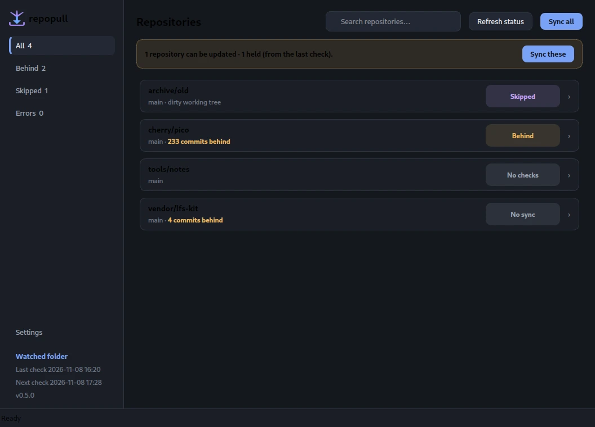

<p align="center">
  
</p>

# repopull

The purpose of this app is to keep local mirrors of third-party repositories current with their remotes —
safely, politely, and without ever touching the remotes.

The app watches a folder of remote third-party repositories. Then it discovers them, fetches each remote **one at a time**, fast-forwards what can be fast-forwarded, and tells you exactly what happened. It never pushes, commits, branches, tags, or opens a pull request.

## Status

**Current release: 0.5.1.** Tests and mypy pass; the latest AppImage was built
from the 0.5.1 tree. No release blockers. The historical
[test audit](docs/test-falsifiability.md) covers 0.2.3; a 2026-11-07 re-audit
covers the 0.4.13 tree at 224 tests; 0.4.14 added one GUI padding test,
0.4.15 added 12 root-state tests, 0.4.16 added 12, 0.5.0 added 15 for
per-repository holds, row labels, Open folder, and Next check (264 at that
release), and 0.5.1 adds 2 scroll-position tests (266 current).
The 16 px icon keeps its branches at the cost of softness (see
[branding](docs/branding.md)).

## The problem the app tries to address

Since the remote repos might be under heavy development, they might change frequently. As a result, the local, watched repos also must change constantly. Pulling each one by hand means remembering where they are, which branch each uses, which ones are dirty, and which have force-pushed. `repopull` does that sweep in one pass and gives you a decision-ready
brief instead of one terminal per repo.

## Where the link lives

The tool and the repos are separate. The **only** connection is the `root`
setting in `config.toml`, `--root`, or the GUI's Settings page.

This checkout ships [`config.example.toml`](config.example.toml) with **no
folder baked in**; a new install starts with no folder either. Choose one in
Settings on first run, or copy the example to a local `config.toml` (gitignored)
and set `root`.

To print the path, confirm it exists, and count the repos it finds:

```bash
./repopull.sh where
```

It prints something like:

```
config file: /path/to/config.toml (found)
root:        /path/to/repos (found, 43 repos)
root source: config.toml key "root"
logs:        /path/to/logs
```

The count is a snapshot; the paths come from the current config.

If the folder is missing or not chosen yet, `repopull` says which path it tried,
where that path came from, and the next steps. You never have to remember it.

## Quick start

From this project folder:

```bash
./repopull.sh
```

(`./bin/repopull` is the same launcher; `repopull.sh` is just the root-level
`.sh` convenience wrapper.)

That opens the menu:

```
1) Fetch status (no changes)
2) Sync all
3) Sync selected
4) Force sync selected
5) View last report
6) Quit
```

Start with **1** — it fetches and shows what a sync *would* do, without changing
any working tree.

To call it from anywhere, symlink the launcher:

```bash
ln -s "$PWD/bin/repopull" ~/bin/repopull
```

## Command line

The menu is a wrapper around the same non-interactive commands, so the CLI stays
scriptable. Automatic status refresh is GUI-only and never syncs.

```bash
./repopull.sh where                                  # config file, root, exists?
./repopull.sh list                                   # every label, no network
./repopull.sh status                                 # fetch, change nothing
./repopull.sh status --only 'craft-*'                # subset by glob
./repopull.sh sync                                   # fast-forward safely
./repopull.sh sync --behind                          # only what the last report found behind
./repopull.sh sync --only AppGlider --only fieldcraft
./repopull.sh sync --force --only fieldcraft         # hard reset, explicit
./repopull.sh repair-root                            # preview saved/current disk identity
./repopull.sh report                                 # last brief
./repopull.sh --json status                          # machine-readable
```

`--root`, `--config`, `--no-color`, `--json`, and `--verbose` work before **or**
after the subcommand.

## Desktop GUI (optional)



```bash
./bin/repopull-gui
```

The GUI reads the same `config.toml`, repositories, and `logs/latest.json` as the
CLI. It shows one row per repo with a state chip and counts in the subtitle,
updates each row as the sweep progresses, supports Refresh status, Sync all, and
a detail page with **Open folder** and per-repo bulk-action holds alongside
Force sync. Settings are grouped into Watching, Refresh, Network, Updates, and
Storage sections. See [docs/gui.md](docs/gui.md).

Settings → Refresh can keep repopull in the system tray and refresh status
automatically. Auto-refresh is off by default, status-only, never runs more
often than every 5 minutes, and can pause while the window is hidden or
minimized. 15 minutes or longer is recommended. The countdown is measured from
the last completed check; showing the window or changing the interval does not
restart it. The sidebar, Refresh section, and tray tooltip show the next
scheduled check.

The tray icon is visible while repopull runs; the tray switch controls whether
closing hides to it. The Refresh switches and the interval save immediately.
Other sections use the footer button, which reads **Saved** when clean and
**Save unsaved settings** when there are deferred edits.

It needs PySide6. The launcher uses the system `python3` when PySide6 is
importable, otherwise it lets `uv` provide it for that run.

## AppImage

```bash
make appimage
./dist/repopull-0.5.1-x86_64.AppImage
```

The image bundles Python 3.13, PySide6 and repopull. Run the CLI from it with
`--cli`:

```bash
./dist/repopull-0.5.1-x86_64.AppImage --cli status
```

It keeps `config.toml` and logs in `~/.config/repopull` (or `$REPOPULL_HOME`).
See [docs/packaging.md](docs/packaging.md).

## Safety model

| Situation | Normal `sync` | `--force` |
|---|---|---|
| Clean, behind upstream | fast-forward | hard reset |
| Dirty tracked files | **skip**, report | hard reset |
| Local commits / diverged | **skip**, report | hard reset |
| Detached HEAD | skip, report | skip, report |
| No upstream branch | skip, report | skip, report |
| LFS repo, Git LFS not ready (missing or not enabled) | **skip**, report | skip, report |
| Untracked files present | sync proceeds | sync proceeds |

Hard rules:

- Never push, commit, branch, tag, or open a PR.
- Never modify a dirty working tree without `--force`.
- Never discard commits without `--force`.
- Never run `git clean`; untracked build artefacts survive every run.
- Never check out an LFS repo when Git LFS is not ready (binary missing or
  filters not enabled); that would replace real files with pointer text.
- One run at a time, enforced with an `flock`.

Force sync always asks for confirmation in the menu and prints exactly which repos
it will reset.

## The brief

Counts only, one row per repository. This example is from an earlier run, before
Git LFS was installed:

```
status — 2026-11-05 16:11:23
-------------------------------------------------------------
Repository   Branch   Status      Commits  Detail
empty-repo   -        error                empty repository: no commits (incomplete clone?)
VoiceStudio  main     up-to-date
egui         main     skipped              uses Git LFS but git-lfs is not installed
fieldcraft   develop  up-to-date

Totals: 2 up-to-date, 1 skipped, 1 error in 3.1s
Attention:
  - empty-repo: empty repository: no commits (incomplete clone?)
  - egui: uses Git LFS but git-lfs is not installed

Log: .../logs/20261105-161123-status.log
```

Every run writes `logs/YYYYMMDD-HHMMSS-<mode>.log` and `logs/latest.log`.
Timestamped run logs older than `log_retention_days` (default 30; `0` keeps
forever) are pruned after each run. `latest.log`, `latest.json`, and `.lock`
are never pruned; change the value in Settings → Storage.

## Configuration

Settings live in a local `config.toml` (gitignored); start from
[`config.example.toml`](config.example.toml). Every key is documented in
[docs/configuration.md](docs/configuration.md). The important ones:

```toml
root = "/path/to/repos"
max_depth = 2
delay_between_repos_s = 0.5
update_submodules = true
require_git_lfs_for_lfs_repos = true
log_retention_days = 30
background_mode = false
auto_refresh_s = 0
auto_refresh_pause_when_hidden = false
```

## Project layout

| Path | Purpose |
|---|---|
| `repopull.sh` | Root-level `.sh` entry point (thin wrapper). |
| `bin/repopull` | Launcher; sets `REPOPULL_HOME` and `PYTHONPATH`. |
| `bin/repopull-gui` | Launcher for the optional PySide6 interface. |
| `src/repopull/` | Typed Python package. |
| `src/repopull/gui/` | Optional PySide6 interface. |
| `packaging/` | AppImage build (`python-appimage` + pinned `appimagetool`). |
| `config.example.toml` | Template; copy to a local, gitignored `config.toml`. |
| `docs/` | Architecture, configuration, GUI, packaging, branding, design rationale, test audit. |
| `docs/previews/` | Screenshots used in the docs. |
| `tests/` | Unit and integration tests (throwaway git repos). |
| `workflows/` | The loop spec this tool implements. |
| `NOTES.md` | Original 2026-11-05 survey of the watched world and terminology. |
| `Makefile` | `make test`, `make typecheck`, `make gui`, `make appimage`. |

## Development

```bash
make test        # unit and integration tests, offline, uses temp repos
make typecheck   # mypy --strict
make check       # both
make gui         # launch the optional PySide6 interface
make appimage    # build dist/repopull-0.5.1-x86_64.AppImage
make bump        # increment the patch version
make release     # check, bump the patch, build the AppImage
```

CI runs `make check` on every push and pull request; see
[.github/workflows/ci.yml](.github/workflows/ci.yml).

The version lives in `pyproject.toml` and `src/repopull/__init__.py`. `make bump`
defaults to a patch bump; use `make bump PART=minor` or `PART=major` for a larger
step. `make release` runs the checks, bumps the patch, and rebuilds. See
[CHANGELOG.md](CHANGELOG.md). `tests/test_version.py` also checks the live
AppImage version references in this README and `docs/packaging.md`.

Runtime is Python 3.11+ with **no third-party packages**. Type checking needs
`mypy`; if it is not installed, `make typecheck` falls back to `uvx mypy`.

## Documentation Index

| File | Audience | Tier | Read it when | Purpose |
|---|---|---|---|---|
| [README.md](README.md) | Operator | always | starting any session | Quick start, status, and this index |
| [NOTES.md](NOTES.md) | Domain expert | on-demand | you need the original 2026-11-05 survey or terminology | Repo survey, machine facts, terminology |
| [CHANGELOG.md](CHANGELOG.md) | Maintainer | on-demand | checking what changed in a release | Release history |
| [AUTHORS.md](AUTHORS.md) | Domain expert | on-demand | checking authorship or contribution credit | Authorship and contribution credit |
| [docs/architecture.md](docs/architecture.md) | Maintainer | on-demand | changing the core or tests | Modules, state model, sync flow, test map |
| [docs/configuration.md](docs/configuration.md) | Operator | on-demand | changing settings or CLI behaviour | Keys, environment, commands, exit codes |
| [docs/gui.md](docs/gui.md) | Operator | on-demand | using the desktop interface | Window, settings, LFS help |
| [docs/troubleshooting.md](docs/troubleshooting.md) | Operator | on-demand | a run fails or a repository is skipped | Common failures and repairs |
| [docs/limitations.md](docs/limitations.md) | Operator | on-demand | deciding whether repopull fits | What it does not do |
| [docs/packaging.md](docs/packaging.md) | Maintainer | on-demand | building or debugging the AppImage | Build, runtime, pins, layout |
| [docs/branding.md](docs/branding.md) | Maintainer | on-demand | changing or regenerating icons | Mark, optical cuts, assets, rebuild |
| [docs/design-decisions.md](docs/design-decisions.md) | Domain expert | on-demand | asking why, or weighing an alternative | Decision records and rejected paths |
| [docs/appglider-lessons.md](docs/appglider-lessons.md) | Domain expert | on-demand | researching GitHub API limits or the original GUI direction | 2026-11-05 AppGlider findings and sources |
| [docs/test-falsifiability.md](docs/test-falsifiability.md) | Maintainer | on-demand | assessing test strength or coverage | Mutation/sabotage audits at 0.2.3 and 2026-11-07 |
| [docs/hardening-backlog.md](docs/hardening-backlog.md) | Maintainer | on-demand | planning hardening or evaluating Rust | Resource-safety backlog and language-boundary decision |
| [docs/auto-refresh-plan.md](docs/auto-refresh-plan.md) | Maintainer | on-demand | reviewing the shipped 0.4.3 resident refresh/tray work | Historical 0.4.3 plan and session handoff |
| [workflows/watched-repo-sync.md](workflows/watched-repo-sync.md) | Operator | on-demand | implementing or operating the sync loop | Loop spec, safety rules, acceptance |

## License

repopull is licensed under the GNU Affero General Public License v3.0; see
[LICENSE](LICENSE).

Its GUI and background-work patterns were inspired by
[AppGlider](https://github.com/Vyrnexis/AppGlider), a Python/PySide6 AppImage
manager; notes are in
[docs/appglider-lessons.md](docs/appglider-lessons.md). AppGlider is not a
dependency; no AppGlider code is included.

Authorship: [AUTHORS.md](AUTHORS.md).
