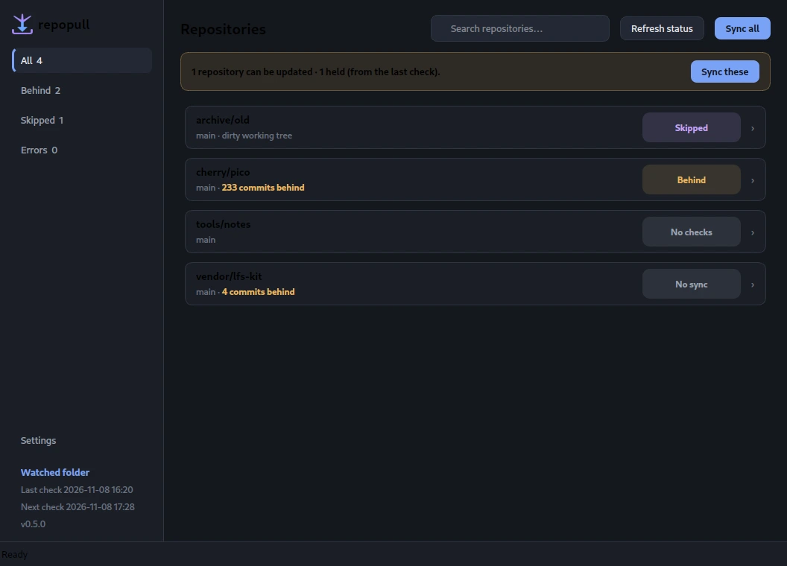

<p align="center">
  
</p>

# repopull

The purpose of this app is to keep local mirrors of third-party repositories current with their remotes —
safely, politely, and without ever touching the remotes.

The app watches a folder of remote third-party repositories. Then it discovers them, fetches each remote **one at a time**, fast-forwards what can be fast-forwarded, and tells you exactly what happened. It never pushes, commits, branches, tags, or opens a pull request.

**Requirements:** Linux, Python 3.11+, and `git`. The CLI needs no third-party
packages; the optional GUI needs PySide6, and the AppImage (x86_64) bundles both.

## Status

**Current release: 0.8.3.** 450 tests and `mypy --strict` pass. The 0.8.3
AppImage is 46 MB, survives a late or unplugged disk, and runs an overdue check
at login. The [test audit](docs/test-falsifiability.md) covers 0.2.3 and the
2026-11-07 re-audit covers 0.4.13; [CHANGELOG.md](CHANGELOG.md) records each
release.

## The problem the app tries to address

Remote repositories under heavy development change constantly, so their local
mirrors must be pulled constantly. Doing that by hand means remembering where
each one is, which branch it uses, whether it is dirty, and which ones have
force-pushed. `repopull` does that sweep in one pass and gives you a
decision-ready brief instead of one terminal per repository.

## Where the link lives

The tool and the repos are separate. The **only** connection is the `root`
setting in `config.toml`, `--root`, or the GUI's Settings page.

This checkout ships [`config.example.toml`](config.example.toml) with **no
folder baked in**; a new install starts with no folder either. Choose one in
Settings on first run, or copy the example to a local `config.toml` (gitignored)
and set `root`.

`./repopull.sh where` prints the config path, the root it resolved, whether that
root exists, how many repositories it finds, and where the logs go. If the folder
is missing or not chosen yet, it says which path it tried, where that path came
from, and the next steps.

## Quick start

From this project folder:

```bash
./repopull.sh
```

(`./bin/repopull` is the same launcher; `repopull.sh` is just the root-level
`.sh` convenience wrapper.)

That opens the menu:

```
1) Fetch status (no changes)
2) Sync all
3) Sync selected
4) Force sync selected
5) View last report
6) Quit
```

Start with **1** — it fetches and shows what a sync *would* do, without changing
any working tree.

To call it from anywhere, symlink the launcher:

```bash
ln -s "$PWD/bin/repopull" ~/bin/repopull
```

## Command line

The menu is a wrapper around the same non-interactive commands, so the CLI stays
scriptable. Automatic status refresh is GUI-only and never syncs.

```bash
./repopull.sh list                                   # every label, no network
./repopull.sh status                                 # fetch, change nothing
./repopull.sh status --only 'craft-*'                # subset by glob
./repopull.sh sync                                   # fast-forward safely
./repopull.sh sync --behind                          # only what the last report found behind
./repopull.sh sync --force --only fieldcraft         # hard reset, explicit
./repopull.sh repair-root                            # preview saved/current disk identity
./repopull.sh clone https://github.com/owner/repo.git  # new mirror folder
./repopull.sh report                                 # last brief
./repopull.sh --json status                          # machine-readable
```

`--root`, `--config`, `--no-color`, `--json`, and `--verbose` work before **or**
after the subcommand. `repopull completions bash|fish` prints a completion
script; see [docs/configuration.md](docs/configuration.md#shell-completions).

## Desktop GUI (optional)



```bash
./bin/repopull-gui
```

The GUI reads the same `config.toml`, repositories, and `logs/latest.json` as the
CLI. It shows one row per repo with a state chip, updates rows as a sweep
progresses, and offers Refresh status, Sync all, **Clone…**, Force sync, and a
detail page with **Open folder** and per-repo holds. Settings are grouped into
Watching, Refresh, Network, Updates, and Storage; see [docs/gui.md](docs/gui.md).

Settings → Refresh can keep repopull in the system tray and refresh status
automatically: off by default, status-only, never more often than every 5
minutes, optionally paused while hidden, and counted from the last completed
check. 15 minutes or longer is recommended. The sidebar, Refresh section, and
tray tooltip show the next check.

The tray switch controls whether closing hides to the tray. The Refresh switches
and interval save immediately; other sections use the footer button, which reads
**Saved** when clean and **Save unsaved settings** when there are deferred edits.

It needs PySide6. The launcher uses the system `python3` when PySide6 is
importable, otherwise it lets `uv` provide it for that run.

## AppImage

```bash
make appimage
./dist/repopull-0.8.3-x86_64.AppImage
```

The image bundles Python 3.13, PySide6 and repopull. Run the CLI from it with
`--cli`:

```bash
./dist/repopull-0.8.3-x86_64.AppImage --cli status
```

It keeps `config.toml` and logs in `~/.config/repopull` (or `$REPOPULL_HOME`).
See [docs/packaging.md](docs/packaging.md).

## Safety model

| Situation | Normal `sync` | `--force` |
|---|---|---|
| Clean, behind upstream | fast-forward | hard reset |
| Dirty tracked files | **skip**, report | hard reset |
| Local commits / diverged | **skip**, report | hard reset |
| Detached HEAD | skip, report | skip, report |
| No upstream branch | skip, report | skip, report |
| LFS repo, Git LFS not ready (missing or not enabled) | **skip**, report | skip, report |
| Untracked files present | sync proceeds | sync proceeds |

Hard rules:

- Never push, commit, branch, tag, or open a PR.
- Never modify a dirty working tree without `--force`.
- Never discard commits without `--force`.
- Never run `git clean`; untracked build artefacts survive every run.
- Never check out an LFS repo when Git LFS is not ready (binary missing or
  filters not enabled); that would replace real files with pointer text.
- Clone only creates a new folder; it never overwrites an existing one or
  writes into a repository that is already watched.
- One run at a time, enforced with an `flock`.

Force sync always asks for confirmation in the menu and prints exactly which repos
it will reset.

## The brief

Counts only, one row per repository. An earlier run, before Git LFS was
installed:

```
status — 2026-11-05 16:11:23
-------------------------------------------------------------
Repository   Branch   Status      Commits  Detail
empty-repo   -        error                empty repository: no commits (incomplete clone?)
VoiceStudio  main     up-to-date
egui         main     skipped              uses Git LFS but git-lfs is not installed
fieldcraft   develop  up-to-date

Totals: 2 up-to-date, 1 skipped, 1 error in 3.1s
Attention:
  - empty-repo: empty repository: no commits (incomplete clone?)
  - egui: uses Git LFS but git-lfs is not installed

Log: .../logs/20261105-161123-status.log
```

Every run writes `logs/YYYYMMDD-HHMMSS-<mode>.log` and `logs/latest.log`.
Timestamped run logs older than `log_retention_days` (default 30; `0` keeps
forever) are pruned after each run. `latest.log`, `latest.json`, and `.lock`
are never pruned; change the value in Settings → Storage.

## Configuration

Settings live in a local `config.toml` (gitignored); start from
[`config.example.toml`](config.example.toml). Every key is documented in
[docs/configuration.md](docs/configuration.md). The important ones:

```toml
root = "/path/to/repos"
max_depth = 2
delay_between_repos_s = 0.5
update_submodules = true
require_git_lfs_for_lfs_repos = true
log_retention_days = 30
background_mode = false
auto_refresh_s = 0
auto_refresh_pause_when_hidden = false
```

## Project layout

Launchers live in `bin/` (`repopull.sh` wraps one), the typed package in
`src/repopull/`, the AppImage build in `packaging/`, and tests and the soak
harness in `tests/` and `tools/`. Modules and data flow are in
[docs/architecture.md](docs/architecture.md); the build is in
[docs/packaging.md](docs/packaging.md).

## Development

```bash
make dev-env     # create .venv with the GUI extra and the pinned tools
make test        # unit and integration tests, offline, uses temp repos
make typecheck   # mypy --strict
make check       # both; refuses to run when PySide6 is missing
make audit       # check packaging pins against known advisories
make soak        # CLI resource soak against throwaway local repos
make soak-qt     # Qt window create/close soak
make gui         # launch the optional PySide6 interface
make appimage    # build dist/repopull-0.8.3-x86_64.AppImage
make bump        # increment the patch version
make release     # check, bump the patch, build the AppImage
```

CI runs `make check` on Python 3.11, 3.13 and 3.15 for every push and pull
request; see [.github/workflows/ci.yml](.github/workflows/ci.yml).

The version lives in `pyproject.toml` and `src/repopull/__init__.py`. `make bump`
increments the patch (`PART=minor` or `PART=major` for more); `make release` runs
the checks, bumps, and rebuilds. See [CHANGELOG.md](CHANGELOG.md).

Runtime is Python 3.11+ with **no third-party packages**. `make check` needs
PySide6 for the GUI tests and `mypy`; `make dev-env` builds a `.venv` with both,
then run `make check PYTHON=.venv/bin/python`. Without `mypy`, type checking
falls back to `uvx mypy`.

## Documentation Index

| File | Audience | Tier | Use it when |
|---|---|---|---|
| [README.md](README.md) | Operator | always | starting any session |
| [NOTES.md](NOTES.md) | Domain expert | on-demand | you need the original 2026-11-05 survey or terminology |
| [CHANGELOG.md](CHANGELOG.md) | Maintainer | on-demand | checking what changed in a release |
| [AUTHORS.md](AUTHORS.md) | Domain expert | on-demand | checking authorship or contribution credit |
| [docs/architecture.md](docs/architecture.md) | Maintainer | on-demand | changing the core or tests |
| [docs/configuration.md](docs/configuration.md) | Operator | on-demand | changing settings or CLI behaviour |
| [docs/gui.md](docs/gui.md) | Operator | on-demand | using the desktop interface |
| [docs/troubleshooting.md](docs/troubleshooting.md) | Operator | on-demand | a run fails or a repository is skipped |
| [docs/limitations.md](docs/limitations.md) | Operator | on-demand | deciding whether repopull fits |
| [docs/packaging.md](docs/packaging.md) | Maintainer | on-demand | building or debugging the AppImage |
| [docs/branding.md](docs/branding.md) | Maintainer | on-demand | changing or regenerating icons |
| [docs/design-decisions.md](docs/design-decisions.md) | Domain expert | on-demand | asking why, or weighing an alternative |
| [docs/appglider-lessons.md](docs/appglider-lessons.md) | Domain expert | on-demand | researching GitHub API limits or the original GUI direction |
| [docs/test-falsifiability.md](docs/test-falsifiability.md) | Maintainer | on-demand | assessing test strength or coverage |
| [docs/hardening-backlog.md](docs/hardening-backlog.md) | Maintainer | on-demand | planning hardening or evaluating Rust |
| [docs/auto-refresh-plan.md](docs/auto-refresh-plan.md) | Maintainer | on-demand | reviewing the shipped 0.4.3 resident refresh work |
| [workflows/watched-repo-sync.md](workflows/watched-repo-sync.md) | Operator | on-demand | implementing or operating the sync loop |

## License

repopull is licensed under the GNU Affero General Public License v3.0; see
[LICENSE](LICENSE).

Its GUI and background-work patterns were inspired by
[AppGlider](https://github.com/Vyrnexis/AppGlider), a Python/PySide6 AppImage
manager; notes are in
[docs/appglider-lessons.md](docs/appglider-lessons.md). AppGlider is not a
dependency; no AppGlider code is included.

Authorship: [AUTHORS.md](AUTHORS.md).
