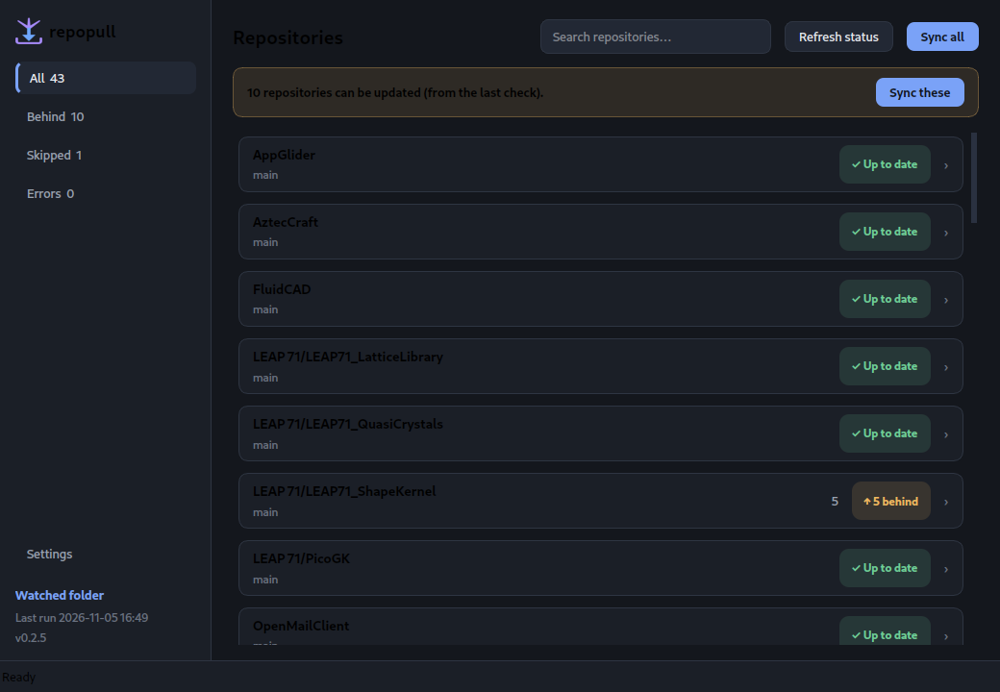
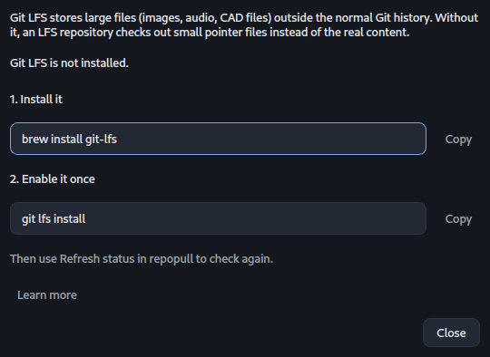
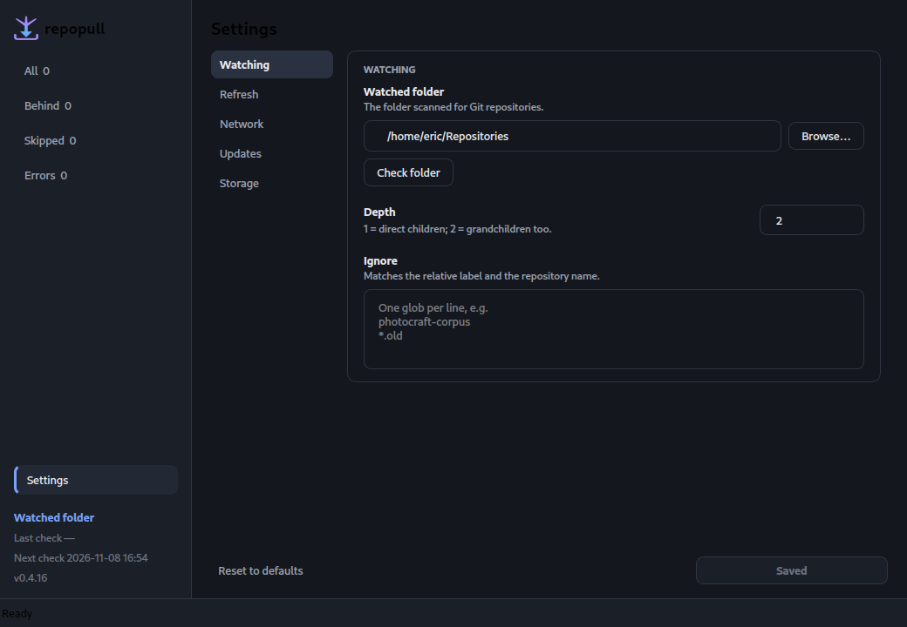

# Desktop GUI

`repopull` has an optional PySide6 interface. It reads the same `config.toml`,
the same repositories, and the same `logs/latest.json` as the CLI. A run from
either is visible to the other.



## Run it

From the project folder:

```bash
./bin/repopull-gui
```

The launcher uses the system `python3` when `PySide6` is importable; otherwise
it lets `uv` provide PySide6 for that run. You can also run
`PYTHONPATH=src python3 -m repopull.gui`.

It runs natively on Wayland and X11; the platform choice is left to Qt.

On first run there is **no watched folder**. Open **Settings** and choose one;
the library then fills. Nothing is hard-coded into the app. The initial scan
runs in a background worker, so a slow or missing mount does not freeze the
window; the empty view says it is scanning until the result arrives.

## What it does

- **Sidebar**: All / Behind / Skipped / Errors with live counts, Settings, a
  **Watched folder** link that opens Settings and focuses the folder field, the
  last run time, the running version, and the mark beside the wordmark. The full
  path lives in Settings and in the link's tooltip.

- **Library**: one row per repository with its branch, a status chip, the commit
  count, and the skip or error reason. **Rows update as each repository is
  checked**, not only when the whole sweep finishes. Search filters by label.
- **Banner**: "N repositories can be updated" with a **Sync all** button.
- **Refresh status** fetches and reports without changing any working tree.
- **Sync all** rechecks every remote, then fast-forwards what is behind. This is
  the correct full sweep: a remote may have moved since the last report.
- **Sync these** (the banner button) is the fast path: it updates only the
  repositories the **last check** found behind. Up-to-date repositories are not
  contacted at all. Refresh status first if the last check is old.
- **Detail page** (click a row): path, branch, upstream, ahead/behind, working
  tree, Git LFS, submodules, remote URL, and the last result.
- **Force sync…** on the detail page resets one repository after a confirmation.
- **Settings**: grouped into Watching (folder, depth, ignore globs),
  Background & refresh (tray, automatic status refresh), Network (delay,
  timeouts), Updates (submodules, LFS), and Storage (logs, retention).
  Background and refresh changes apply immediately; other changes are written by
  **Save settings**. **Reset to defaults** restores the shipped values first. The
  logs path is resolved at runtime from `$XDG_CONFIG_HOME` (or `~/.config`).
  **Keep run logs** sets `log_retention_days`; `0` keeps every run log.
  **Keep running in the system tray** is close-to-tray; the tray icon is visible
  whenever the app runs, and the checkbox controls whether closing hides to it.
  Normal minimize stays in
  the taskbar. **Check folder** also scans in the background. **Refresh status
  automatically** is status-only, off by default,
  has a 5-minute hard floor, and shows an orange warning below 15 minutes. A
  manual status or sync resets the next automatic run. On Linux, when automatic
  refresh is on, a wake from suspend is detected and the app waits 60 seconds for
  the desktop and network to settle before running one status check; missed
  intervals are not queued. If a run was in flight, that run finishes first.
  Two consecutive network-level fetch failures stop that sweep and mark the
  remaining repositories "not attempted"; automatic retries are 2, 5, 15, 30,
  and 60 minutes, so a reconnect is noticed quickly without repeatedly timing
  out every repository.
  With background mode on, the symbolic tray menu offers Open, Refresh status
  now, Pause/Resume automatic refresh, and Quit. Quit cancels the current git
  command, waits for the worker to unwind, and releases the locks. A cancelled
  git command can leave that repository with a lock or partial checkout; the
  next run reports it rather than forcing a repair. A second GUI launch refuses
  to start.
  The **Git LFS** row shows whether `git-lfs` is installed and enabled;
  **Help…** explains what LFS is and shows the install command for the detected
  distribution plus `git lfs install`. Nothing is installed or run automatically.
  The same help appears on a repository's page when LFS is why it cannot sync.

The window/taskbar icon and the sidebar mark are documented in
[branding.md](branding.md).





## Safety

The GUI calls the same `status_report` and `sync_report` functions as the CLI. It
never pushes, commits, or cleans. A normal run skips dirty and diverged
repositories; Force sync is the only destructive path and asks first. Updates
are refused if the repository path no longer resolves inside the watched root.
The GUI holds the same `logs/.lock` as the CLI, so two runs cannot overlap.

## Limitations (prototype)

- No desktop notifications.
- No per-repository selection for a normal sync; use Sync all, or Force sync one.
- Saving general settings rewrites `config.toml` and drops hand-written
  comments; background and refresh changes use a targeted writer that preserves
  them.
- The window is dark-only.
- Keyboard navigation is basic.

## Tests

`make test` runs the GUI tests offscreen (`QT_QPA_PLATFORM=offscreen`) and skips
them when PySide6 is absent.
For the full documentation index, see [README.md](../README.md#documentation-index).
